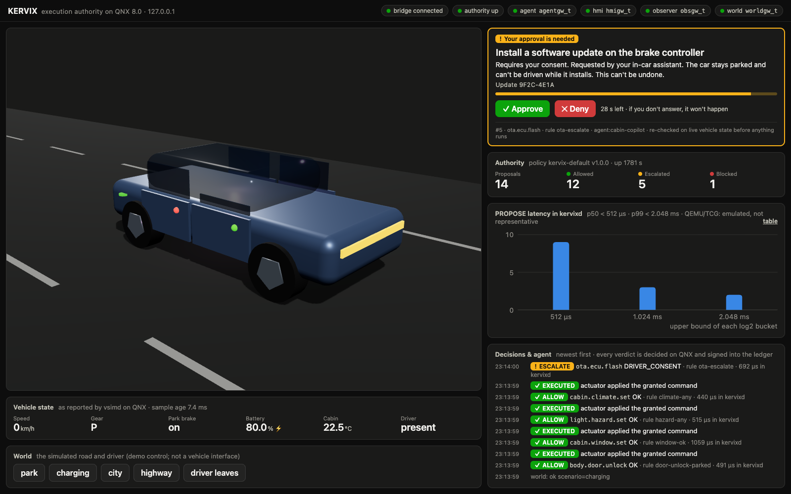
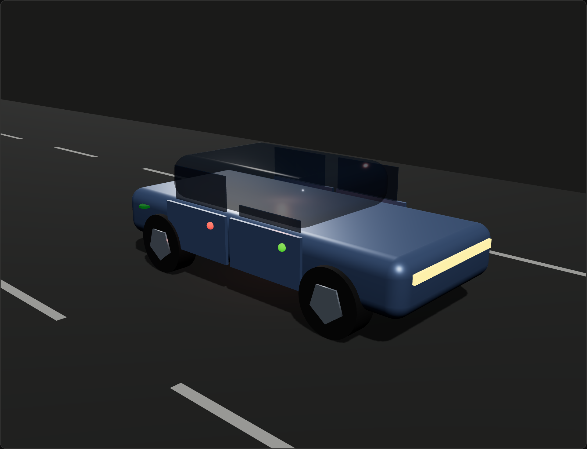
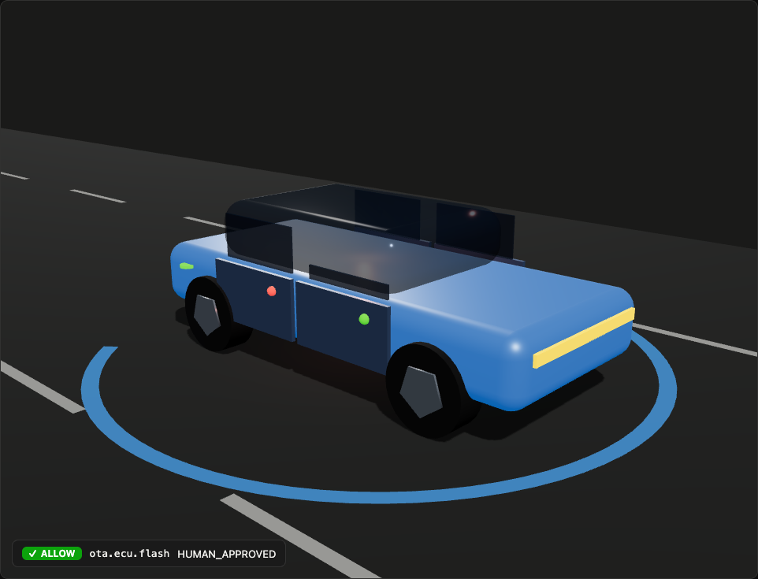
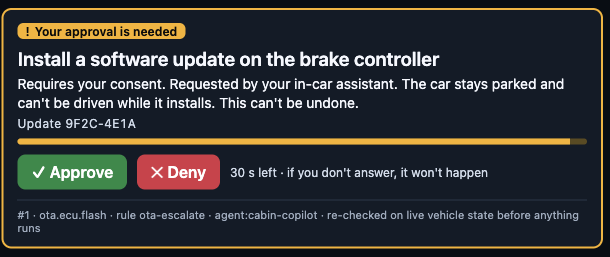

# Kervix

**Kernel-enforced execution authority for software-defined vehicles, on QNX 8.0.**

AI agents *propose* vehicle actions. Kervix decides in microseconds, on live vehicle state, whether each action is **ALLOWED** (with a single-use grant), **ESCALATED** to the driver, or **BLOCKED**. QNX security policies make every other path to an actuator impossible at the kernel's IPC layer. Every decision becomes an Ed25519-signed, chained [Agent Action Capsule](docs/03-architecture.md#82-capsules-aac-draft-04--mapping-frozen-by-spike-s5) that anyone can verify, and replay, offline.

**Propose. Prove. Actuate.**



*The dashboard, live against QNX 8.0 in QEMU. The agent asked to flash the brake ECU; Kervix escalated it to the driver. Every verdict in the feed was decided by `kervixd` on QNX.*

| The vehicle, as QNX reports it | After the driver approves an OTA update |
|---|---|
|  |  |
| The procedural 3D twin renders **telemetry, never requests**. An action shows up only after Kervix allowed it, the actuator applied it, and the simulator published the new state. Here: front-left door unlocked (green light), its window lowered, hazards on, charge port glowing. | The driver approved; the agent's waiting request received a fresh grant and executed. The vehicle reports the flash in progress (blue glow, turning halo). The approval is a signed capsule naming the human approver. |

**The driver's on-screen notification.** Actions that need a human are pushed to the HMI by a kernel pulse (no polling). They are re-checked on live vehicle state before any grant is issued, and refused if nobody answers in time:



If the authority itself dies, nothing moves: [AUTHORITY OFFLINE · ACTUATION LOCKED](docs/evidence/dashboard-qnx-qemu-authority-offline.png), until `kx-supervisor` brings it back (≈ 0.1 s under emulation) with the restart recorded in the signed ledger.

> 🚧 Built for the QNX Global Hackathon (Nov 20 – Dec 15, 2026). Status: [`docs/progress.md`](docs/progress.md). Design: [`docs/`](docs/README.md).

## How it works

```
 HOST ("AI / infotainment domain")                    QNX 8.0 TARGET ("safety domain")
 ┌──────────────────────────────┐                     ┌─────────────────────────────────────────────────────────────┐
 │ agent (Claude or scripted)   │                     │ kxgw agent    agentgw_t uid 400 prio 10 ─▶ /dev/kervix/intent │
 │ dashboard (React + R3F)      │◀─ host/bridge ─TCP─▶│ kxgw hmi      hmigw_t   uid 401 prio 30 ─▶ /dev/kervix/escalations
 │ kervix-verify (offline)      │                     │ kxgw observer obsgw_t   uid 402 prio 5  ─▶ /dev/kervix/stats   │
 └──────────────────────────────┘                     │ kxgw world    worldgw_t uid 403 prio 5  ─▶ /dev/sdv/sim/ctl    │
                                                      │                                                               │
                                                      │ kervixd (kervix_t → kervix_run_t): policy · grants · ledger   │
                                                      │   ▲ redeem (interlock re-check)        ▲ telemetry (seqlock)  │
                                                      │ sdv_actuatord (actuator_t) ──▶ vsimd (vehicle simulator)      │
                                                      │ kx-supervisor (supervisor_t): restarts kervixd, fail closed   │
                                                      └─────────────────────────────────────────────────────────────┘
```

- **Topology before policy.** Every Kervix path is its own resource-manager channel, typed by the QNX security policy (`secpol`). The kernel refuses any connection the policy does not list (`EPERM`, even for root). An agent cannot reach the actuators, the raw maintenance path, the driver's approval channel or the simulator. It can only *propose*.
- **Decide on live state.** `kervixd` hashes each proposal as an Agent-Safe Intent v1 and checks the constitution (fresh, plausible telemetry; a healthy audit log). It then evaluates the policy first-match against a lock-free telemetry snapshot. The answer is ALLOW (an HMAC'd, single-use, TTL-bound grant), ESCALATE (to the driver) or BLOCK (with a reason).
- **Re-check at the last moment.** The actuator redeems a grant once. Before anything moves, the authority re-checks the MAC, expiry, exact parameters and proposer binding, and re-evaluates the rule's interlock on the vehicle's state *now*.
- **Prove it.** Every decision, approval, effect and restart is a signed, chained AAC draft-04 capsule in an append-only ledger ("no audit, no action"). `kervix-verify` checks signatures and chain offline. It also **re-runs every decision with the vehicle's own C policy core compiled to WebAssembly**, so a signed lie is caught.

Policies are YAML compiled by `kxpolicy` (`npm run kxpolicy`), tested on the vehicle's own C core (`npm run policy:test`), signed by an author and a different approver, and activated only through the operator's channel.

Details: [architecture](docs/03-architecture.md) · [design](docs/02-product-design.md) · [decisions](docs/decisions.md) · [QNX lessons learned](codelab/NOTES.md).

## Verified on QNX 8.0

`kx-selftest` runs every safety and security claim **on the target**, as the real roles under their real secpol types and uids, and prints one PASS/FAIL table:

| | Result |
|---|---|
| Dev image (every Kervix type restricted) | **29/29 PASS** · [table](docs/evidence/selftest-qnx-qemu-open.txt) |
| Release image (`--secpol=secure`: one complete policy, nothing runs untyped, root's shell confined) | **29/29 PASS** · [table](docs/evidence/selftest-qnx-qemu-secure.txt) |
| The run's signed dossier, verified offline on the host | **VERIFIED**: signatures, chain across restarts, 17/17 decisions replayed |
| Red team (`kx-rogue`, 10 attacks as the deployed agent) | **0/10 open**, all refused by the kernel |
| Signed policy updates (author ≠ approver, verified on the vehicle, activated, persisted, replayed offline) | **15/15** · `make target-policy` |
| `kx-bench` (QEMU/TCG, emulated: ratios matter, not µs) | PROPOSE p50 39 µs / p99 167 µs in `kervixd`; the driver HMI's p99 is **1.03×** idle under a 16.6k proposals/s agent flood · [output](docs/evidence/bench-qnx-qemu.txt) |

Host CI runs on every push: the portable C core and its tests (including ASan/UBSan and TSan), a libFuzzer run on the gateway parser, AAC/COSE conformance against `@decionis/verify`, verification of a committed QNX-signed dossier, the replay engine rebuilt from source, and the TypeScript bridge, agent and dashboard.

*All QNX results so far are from QEMU on an Apple-silicon Mac (TCG emulation). Raspberry Pi 4 results replace the latency numbers once the hardware arrives (Dec 3).*

## Build and run

**Target:** QNX SDP 8.0 · QEMU `x86_64` (Raspberry Pi 4 `aarch64le` is cross-built on every build) · `qcc` (gcc 12.2) + CMake.
**Host:** Node ≥ 22.18 (TypeScript runs via type stripping), a C11 compiler, CMake ≥ 3.20, Docker (macOS) and QEMU.

### Host-only (no QNX needed)

```bash
npm ci
make test                      # C core + unit tests, codegen check, TS tests, AAC/COSE conformance
node host/verify/kervix-verify.mjs tests/fixtures/dossier-qnx-qemu-2026-11-20   # verify a real QNX-signed dossier
```

### QNX 8.0 in QEMU

One-time SDP setup: [docs/setup-macos.md](docs/setup-macos.md). On macOS the SDP's Linux host tools run in Docker; on native x86_64 Linux, source `qnxsdp-env.sh` and use the same commands.

```bash
make target                    # cross-build every component for x86_64 and aarch64le
make target-selftest           # boot QNX 8.0 in QEMU, run kx-selftest, verify its dossier on the host
make target-selftest-secure    # the same on the --secpol=secure release image
make help                      # every target: m1, escalation, ledger, secpol, supervisor, kxgw, bridge, agent, bench
```

### The demo: dashboard + agent

With a target image running (for example after `make target-agent`, which leaves the gateway image up):

```bash
npm run dashboard              # build the dashboard once
npm run bridge                 # http://127.0.0.1:8787 : bridge to the QNX gateways + dashboard
npm run agent -- script scenarios/s1-cold.json scenarios/s2-injection.json scenarios/s3-escalate.json
                               # scripted agent: real verdicts from QNX, recorded words (no API key)
npm run agent -- live "I'm cold"   # live Claude agent (claude-opus-5-5; needs Claude API credentials)
```

Scene 2 feeds the agent a **synthetic poisoned service bulletin** that tells it to flash the brake ECU while driving. The agent tries; Kervix blocks it (`R156_NOT_SAFE_STATE`). The agent's system prompt contains **no safety rules**: safety must not depend on the model behaving.

## Repository

```
target/      QNX 8.0 C11: libkxcore (portable policy/intent/grant/capsule core), kervixd, vsimd, sdv_actuatord,
             kxgw, kxctl, kx-supervisor, kx-selftest, kx-bench, kx-rogue; secpol/ policies; image/ boot snippets
host/        bridge/ (Node), agent/ (Claude + scripted), dashboard/ (React + R3F), verify/ (kervix-verify + WASM replay)
catalog/     the action/telemetry/reason catalog: one source for C headers, TS types and Claude tool schemas
policies/    the vehicle policy (YAML)      scenarios/  scripted agent scenes + synthetic documents
tests/       conformance (vs @decionis/verify), QNX target suites (tests/target/*.sh)
docs/        design, decisions, progress, evidence/ (selftest tables, bench output, screenshots)
codelab/     notes for the QNX codelab: secpol, resource managers, qcrypto, supervision, gateways
```

## Disclosure

Kervix was built during the hackathon window. It depends on [`@decionis/verify`](https://www.npmjs.com/package/@decionis/verify), an open-source AAC verifier by the same author that **predates the hackathon**, used here only as a verification dependency. Registering the `follows` relation and the `vehicle.*` effect namespace in that verifier is an upstream contribution made during the hackathon ([decionis/Decionis#1752](https://github.com/decionis/Decionis/pull/1752), in review); until it is released, `kervix-verify` reports them as informational findings.

## License

Apache-2.0. See [LICENSE](LICENSE).
