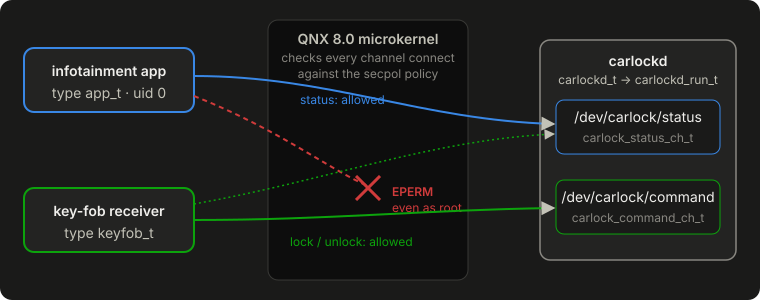

# Lock it down: kernel-enforced least privilege for a QNX 8.0 resource manager

**Codelab · QNX SDP 8.0 · about 45 minutes · C, secpol, QEMU**

You will build a tiny car-lock service for QNX 8.0. Any app may ask whether the car is locked, but only the key fob may unlock it. You will **not** put an `if (caller == keyfob)` check anywhere in its code. Instead you will write a security policy, and the **QNX microkernel itself** will refuse every other caller. That includes a process running as **root** with the app's type.

This is the mechanism [Kervix](../README.md) is built on. An AI agent in a car can *propose* actions, but QNX makes every other path to an actuator impossible. Here you learn it on 120 lines of C.



## What you'll learn

- Why a resource manager should give **each trust level its own channel**, and how `secpol_resmgr_attach()` lets the policy give each channel a type.
- How to write a **secpol policy**: process types, typed channels (`allow_attach … <channel type>`), connect rules, and a one-way **privilege drop** (`derive_type` + `settypeid`).
- How a server learns **who is calling** from the type the kernel stamps into every message (`ctp->info.type_id`).
- How to try a policy safely (`--secpol=open`, `restricted` types) and read the kernel's **refusal log**.
- The gotchas that cost us time building Kervix (see [§ Gotchas](#gotchas)).

## What you'll need

- **QNX SDP 8.0** with a free [QNX Everywhere](https://qnx.software/en/developers/get-started/qnx-everywhere) licence.
- A host that runs the SDP: x86_64 Linux natively, or macOS through the SDP's Linux tools in Docker ([our setup guide](../docs/setup-macos.md)).
- QEMU, to boot a QNX 8.0 image built with `mkqnximage`.
- The code: [`codelab/carlock/`](carlock). It is self-contained: one header, a daemon, a client and a policy.

> **One command:** in this repository, [`codelab/run.sh`](run.sh) runs every step below on QEMU and checks each result. On QNX 8.0 it prints `CODELAB RESULT: PASS` (8/8). Every output shown below comes from that run.

---

## Step 1 · Split the service by trust level

The car lock has two operations with very different risk:

| Path | Operation | Who should be able to use it |
|---|---|---|
| `/dev/carlock/status` | read: locked or not? | any app, and the key fob |
| `/dev/carlock/command` | lock / unlock | **only** the key fob |

On QNX, a client talks to a resource manager over a **channel**. Secpol types *channels*, not paths. So the decisive design choice is that **each path gets its own channel**, which means its own `dispatch_t`:

```c
/* carlockd.c */
for (int i = 0; i < 2; i++) {
    node_t *n = &nodes[i];
    n->dpp = dispatch_create();          /* one dispatch structure = one channel = one channel type */
    iofunc_func_init(_RESMGR_CONNECT_NFUNCS, &n->cf, _RESMGR_IO_NFUNCS, &n->io);
    n->io.devctl = io_devctl;
    iofunc_attr_init(&n->attr, S_IFCHR | 0666, NULL, NULL);
    secpol_resmgr_attach(NULL, n->dpp, NULL, n->path, _FTYPE_ANY, 0, &n->cf, &n->io, &n->attr, NULL);
}
```

`secpol_resmgr_attach()` works like `resmgr_attach()`, with two differences. The policy decides whether this process may attach the path at all, and which **type** the resulting channel gets. Without a policy it simply attaches.

> If both paths shared one dispatch channel, they would share one channel type. Any client allowed to *read* the status could then also send unlock messages.

## Step 2 · Who is calling? Ask the kernel, not the client

Notice the file permissions above: `0666`. Anyone may open both paths, as far as the file system is concerned. The daemon also contains **no authorization check**. It only reports *who* called, and the kernel provides that information:

```c
/* in io_devctl(): the sender's secpol type, stamped by the kernel on every message */
m->caller_type = ctp->info.type_id;
const char *name = secpol_get_type_name(NULL, m->caller_type);
```

The type travels with each message, so it costs no extra system call and cannot be forged by the client.

**Build it** in the SDP environment:

```bash
qcc -Vgcc_ntox86_64 -Wall -o carlockd carlockd.c -lsecpol
qcc -Vgcc_ntox86_64 -Wall -o carlock  carlock.c  -lsecpol
```

The client takes one argument: `status`, `lock`, `unlock`, or `squat` (it tries to attach `/dev/carlock/command` itself, i.e. impersonate the daemon).

## Step 3 · Write the policy

[`carlock.secpol`](carlock/carlock.secpol) is the whole policy:

```text
type carlockd_t;          # the daemon, while it sets up
type carlockd_run_t;      # the daemon, after it dropped its privileges
type app_t;               # an infotainment app: may read the lock state
type keyfob_t;            # the key-fob receiver: may lock and unlock

type carlock_status_ch_t;   # the channel behind /dev/carlock/status
type carlock_command_ch_t;  # the channel behind /dev/carlock/command

# Who may attach which path, and the type the resulting CHANNEL gets.
allow_attach carlockd_t /dev/carlock/status  carlock_status_ch_t;
allow_attach carlockd_t /dev/carlock/command carlock_command_ch_t;

# Who may connect to which channel. Nothing else is allowed.
allow { app_t keyfob_t } carlock_status_ch_t:channel connect;
allow keyfob_t           carlock_command_ch_t:channel connect;

# One-way privilege drop: carlockd_t may become carlockd_run_t (and nothing else).
derive_type carlockd_t run carlockd_run_t;
allow carlockd_t self:ability { settypeid:carlockd_run_t };
```

Three ideas carry the whole policy:
1. **`allow_attach … <channel type>`**: only `carlockd_t` may attach these paths, so nobody can squat them. The trailing type is the type of the *channel*.
2. **`allow X <channel type>:channel connect`**: the topology. A connect that is not listed is refused **inside the kernel** when the client calls `open()`.
3. **The privilege drop:** after attaching, the daemon needs nothing more. It calls `secpol_transition_type(NULL, NULL, 0)` and becomes `carlockd_run_t`, which has no attach rights. If it is ever compromised, it cannot attach anything new. Both rules are required: `derive_type` names the target, and the `settypeid` ability permits the switch.

Check the syntax on the host:

```bash
secpolcompile -o carlock.secpol.bin carlock.secpol
```

## Step 4 · Boot QNX with the policy, still in learning mode

Build a QEMU image with secpol in **open** mode and your policy as the base:

```bash
mkqnximage --type=qemu --arch=x86_64 --secpol=open --policy=$PWD/carlock.secpol --build
```

In open mode, `secpolgenerate` runs alongside the kernel. Anything your policy does not cover is *learned* rather than refused, so the rest of the system keeps working while you develop. Copy the two binaries to the target (`/data/codelab`) and run every role with **`on -T <type>`**. This starts a program under a given secpol type, like `on -u` does for a user id:

```bash
on -T carlockd_t ./carlockd &
on -T app_t    ./carlock unlock
```

At this point the app **can** unlock the car:

```text
PASS  without enforcement, the infotainment app CAN unlock the car
```

That is expected: the types exist, but nothing holds them to the policy yet.

## Step 5 · Enforce it

Tell `secpolgenerate` to hold **your** types to the policy, and leave the rest of the system learning. Add these lines to `/data/var/secpol/config` on the target, then reboot:

```text
type carlockd_t restricted
type carlockd_run_t restricted
type app_t restricted
type keyfob_t restricted
```

Run the same commands again. These are the real outputs from QNX 8.0:

```text
-- app_t status
carlock: I am uid 0, type app_t
status: OK, the car is LOCKED (carlockd saw caller type app_t)
-- app_t unlock
carlock: I am uid 0, type app_t
unlock: REFUSED: open /dev/carlock/command: Operation not permitted
-- keyfob_t unlock
carlock: I am uid 0, type keyfob_t
unlock: OK, the car is UNLOCKED (carlockd saw caller type keyfob_t)
-- app_t squat
carlock: I am uid 0, type app_t
squat: REFUSED: Operation not permitted
-- carlockd
carlockd: ready, pid 843799, running as type carlockd_run_t
carlockd: UNLOCKED by type keyfob_t
```

Look at what happened:
- **`uid 0`:** every one of these processes is **root**. The app is refused anyway, because the refusal comes from its *type*, not its user id.
- **The refusal is at `open()`.** The unlock message is never even sent. `carlockd` never sees the attempt, so there is no authorization code in the daemon that could have a bug.
- **Squatting fails:** a process of type `app_t` cannot attach `/dev/carlock/command` to impersonate `carlockd`.
- **The privilege drop happened:** `carlockd` runs as `carlockd_run_t`.

## Step 6 · Ask the kernel why

Every refusal of a restricted type is logged. On the target:

```bash
slog2info | grep secpolgenerate
```

```text
carlock (pid:876566 type:app_t) failed to use ability channel_connect:carlock_command_ch_t as root
carlock (pid:913430 type:app_t) failed to use ability pathspace as root
```

The log names the exact rule a process would have needed. Use it while you develop: run your system, read the log, decide whether each line is a missing rule or an attack. Squatting is refused even before `allow_attach` is consulted, because creating a path at all needs the `pathspace` ability, which `app_t` doesn't have.

## Step 7 · Ship it: `--secpol=secure`

Open mode is for development. For the release image you want **one complete policy**: nothing learns, and every process is typed. The workflow we use in Kervix (`scripts/secpol-harvest.sh`) is:

1. **Harvest.** Boot the open image with all your types `restricted`, exercise everything the product does, and save what `secpolgenerate` learned for the *rest* of the system (`/dev/secpolgenerate/policy`). Keep only the blocks for system services. Your own types stay hand-written, so learning can never widen them.
2. **Review** every learned rule, and commit it next to your hand-written policy.
3. **Build** with `mkqnximage --secpol=secure --policy=<your policy + the harvested system policy>`.

In secure mode even the root shell is confined. In Kervix, root cannot start a process as the authority's type (`settypeid` refused), so it cannot launch a fake authority. The same red-team suite passes there: [`tests/target/secpol.sh secure`](../tests/target/secpol.sh).

---

## Gotchas

Each of these cost real time while building Kervix:

- **Restricted, or it doesn't count.** In `--secpol=open` mode, a type that is *not* marked `restricted` ignores your connect rules. Your policy then appears to "not work" until you add `type X restricted` to `/data/var/secpol/config` and reboot.
- **The privilege drop needs two rules:** `derive_type A run B` and `allow A self:ability { settypeid:B }`. With only one of them, `secpol_transition_type()` fails.
- **Get the caller's type from the message.** `ctp->info.type_id` is stamped by the kernel on every message. On 8.0, `ConnectClientInfoExtraArgs(..., &type_id)` returned `SECPOL_INVALID_TYPE` for us, so don't rely on it.
- **Inherited connections are not re-checked.** `channel connect` is checked when a connection is *made*. A file descriptor a process inherits (for example its stdout, redirected to a log file by the shell that started it) is reused without a new check. A service can then "work" without the rule it needs, until someone starts it differently. List every service a daemon uses in the policy explicitly. Have launchers pass output through a pipe instead of leaking file descriptors (Kervix's `kx-supervisor` does exactly this).
- **Sockets need `network/jailroot`.** A typed, non-root process that opens a socket must be granted `network/jailroot` (and `channel connect` to `io_sock_t`). Without it, `bind`/`listen` fail with `EPERM`.
- **`mkqnximage` remembers options between builds.** A "plain" build after a `--secpol=secure` one is still secure. Always pass every security option explicitly.
- **`slay` exits with the number of processes it signalled.** Under `set -e`, a *successful* `slay` aborts your script. Append `; true`.

## Where to go from here

- **Kervix** ([README](../README.md)) applies this to a whole vehicle stack. It uses **one dispatch channel per trust level** for the AI agent, the driver's HMI, the actuator, the observer and the workshop. Its red-team tool `kx-rogue` tries ten ways around it; as the deployed agent, all ten are refused by the kernel. See [`target/secpol/kervix.secpol`](../target/secpol/kervix.secpol) and [`codelab/NOTES.md`](NOTES.md) for every lesson in full.
- **Policy on top of topology.** Secpol decides *who may talk to whom*. Kervix's authority then decides *what may happen now* (is the car moving? did the driver approve?). An attacker has to defeat both.

*Written during the QNX Global Hackathon 2026. Code and text: Apache-2.0.*
